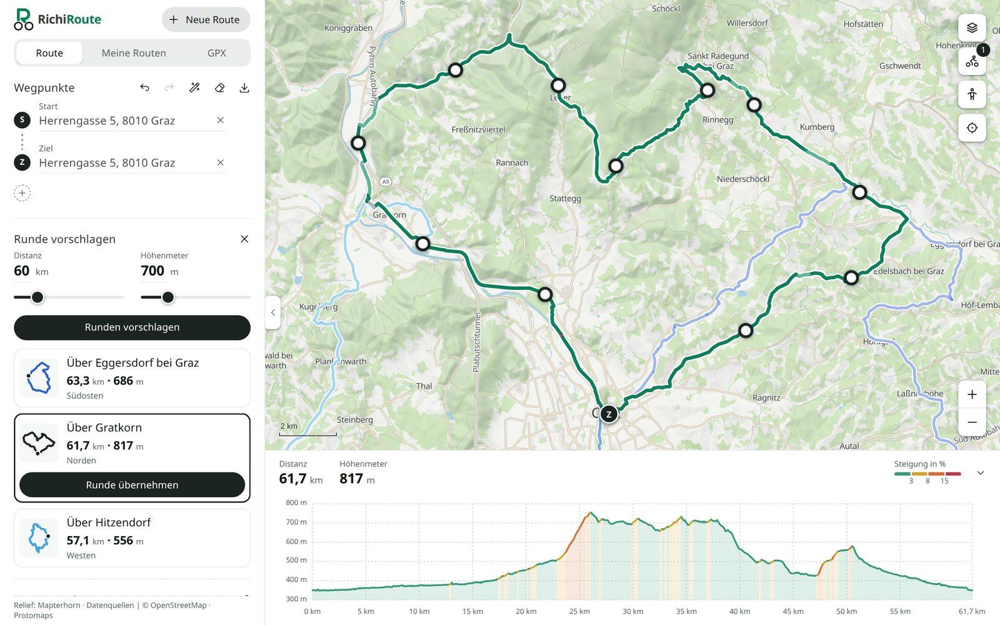

# RichiRoute

A route planner for road cyclists: it suggests round trips from your start, routes along roads that suit a road
bike, and shows the climbs and the road surface before you ride.



RichiRoute runs on your own computer, with its own routing engine, maps and address search. Online services are
contacted only for what you choose: OpenTopoMap, signed cycle routes, Street View, and aerial photos not saved
locally. The interface is in German. The project is in
active development and tested around Graz and Styria, Austria.

## What you can do

**Plan**

- Get three round-trip suggestions from your start for a distance (10 to 1,000 km) and climbing target, each shown
  with its shape, distance and climbing; pick one to see it as a route and keep it.
- Plan a route through any number of stops; set them by address or on the map.
- Drag the route onto the road you prefer and reorder stops in the list, with undo and redo.

**Check before you ride**

- See distance and climbing, and an elevation profile coloured by gradient; zoom it into any stretch for that
  stretch's length, climbing and steepest gradient.
- See the road surface along the route (paved, probably paved, cobblestones or wooden bridges, unpaved, unknown)
  and highlight each section on the map.
- Look at Google Street View from any point on the map or the profile.
- Switch between a local map with shaded relief, an aerial view with street names, and OpenTopoMap online; show
  cycle paths, signed cycle routes, drinking water, bike shops, food stops and railway stations.

**Keep and share**

- Save routes in **Meine Routen**, reopen, rename and duplicate them.
- Download a route as GPX for your bike computer, or as a RichiRoute file to keep it editable.
- Open a GPX track to compare it with your route, or turn it into an editable route.

Routing prefers paved roads, so unpaved sections are rare but possible. Where the map
data records no surface, the road type usually tells; the rest is marked as unknown. When the map data has a surface
wrong, you can correct it in the local planner, and routing uses the correction from then on.

## Status and limits

- **Platform:** the planner and its services run on Linux (x64). Open it in a browser on the same computer; desktop
  and phone-sized windows are supported.
- **Coverage:** routing covers 5–20° E and 45–50° N (Austria and the neighbouring regions). Maps, address search and
  aerial overview cover Europe; detailed aerial photos cover Austria, Switzerland and France.
- **Your data:** routes are stored in your browser. There are no accounts and no cloud sync; download RichiRoute
  files to keep copies, because clearing the browser's data removes saved routes.
- **Not yet:** using it offline on a phone, without the computer, is a goal but not available yet.

## Getting started

You need Linux on x64, about 100 GB of free disk space (the European map is about 25 GB, address search about 50 GB
and more while it installs), and the verified routing bundle `richiroute-ubuntu-benchmark/` placed next to this
checkout. The bundle is not part of this repository, and there is no download command for it yet.

```sh
node scripts/setup-native.mjs            # Node, GraalVM and Rust runtimes (any Node 22 or newer runs it)
export PATH="$PWD/.cache/runtime/node/bin:$PATH"
npm ci
npm run search:setup                     # address search
npm run maps:setup                       # European street map
npm run terrain:setup                    # shaded relief
npm run dev:local                        # starts everything
```

Then open **http://127.0.0.1:5173/**. The first downloads are large and take a while. Aerial photos
(`npm run imagery:setup`) and the cycling overlays (`npm run cycling:setup`) are optional. Ctrl+C stops all
services.

**First steps:** click the map to set a start, then a destination; further clicks add stops. Or set only a start and
choose **Runden vorschlagen** for round trips. Drag the route to take another road (on a phone, hold it briefly
first). **Neue Route** starts over; a changed route is kept in **Meine Routen** as a draft (Entwurf).

The [local development guide](docs/local-development.md) covers every step in detail: data coverage and updates,
offline aerial areas, online map choices, an optional Google Maps key for Street View inside the planner, and how
each feature works.

## Development

Without the routing bundle you can still build the planner and run its tests (Node 26.12.1, see `.nvmrc`):

```sh
npm ci
npm test               # unit tests
npm run build          # planner
npm run bench:test     # comparison app tests
npm run bench:build    # comparison app
```

`npm run dev` starts only the planner's frontend; route calculation needs `npm run dev:local`. Browser tests and
the other checks are listed under [checks](docs/local-development.md#checks).

| Folder | Contents |
|---|---|
| `src/` | The planner: Vue 3, Vuetify, TypeScript, Pinia, MapLibre GL JS |
| `engine/` | The routing engine, a Rust port of BRouter 1.7.10 that answers exactly as BRouter does ([porting notes](engine/PORTING.md)) |
| `config/` | Shared routing rules: local passage exceptions, turns, avoidances, surface corrections ([workflow](docs/local-development.md#managing-local-routing-rules)) |
| `scripts/` | Setup and the local launcher (`start-local.sh`) |
| `tests/` | Unit and browser tests |
| `experiments/routing/` | A comparison app for BRouter, GraphHopper and openrouteservice, and rider-reviewed routes kept as regression checks ([routing guide](experiments/routing/README.md)) |
| `docs/` | The [local development guide](docs/local-development.md) |

Downloaded runtimes, map data, build output and local benchmark recordings stay outside version control.

## Data and credits

Map and routing data © [OpenStreetMap](https://www.openstreetmap.org/copyright) contributors. Vector tiles by
[Protomaps](https://protomaps.com/), address search by Photon, relief by Mapterhorn. Aerial imagery from Copernicus
Sentinel, basemap.at, swisstopo and IGN; every source is credited in the planner. The routing engine is ported from
[BRouter](https://github.com/abrensch/brouter) (MIT, see [`engine/LICENSE-BROUTER`](engine/LICENSE-BROUTER)). Icons
from [Tabler Icons](https://tabler.io/icons) (MIT); checkboxes and radio buttons use the shapes of
[Material Design Icons](https://pictogrammer.com/mdi/) (Apache 2.0).
